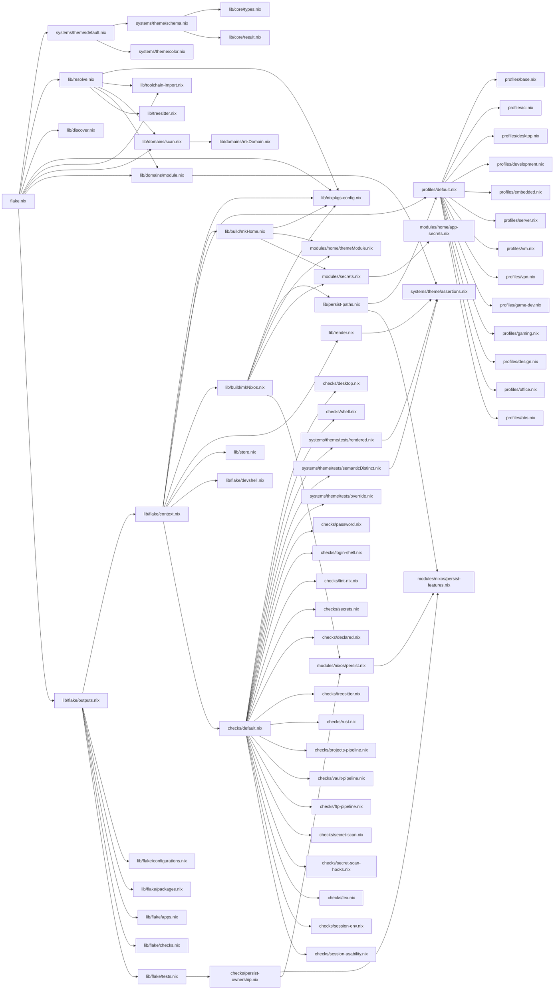

# angst flake analysis

*Generated: 2026-10-21 08:53*

## Table of Contents

- [1. Overview](#overview)
- [2. File Size Heatmap (top 30)](#file-size-heatmap-top-30)
- [3. Directory Size Breakdown](#directory-size-breakdown)
- [4. Attribute Surface](#attribute-surface)
- [5. Configuration Matrix](#configuration-matrix)
- [6. Domain Feature Coverage](#domain-feature-coverage)
- [7. Dependency Fan-in / Fan-out](#dependency-fan-in-fan-out)
- [8. Module Coupling Graph](#module-coupling-graph)
- [9. Build Graph Depth](#build-graph-depth)
- [10. Duplication Hotspots](#duplication-hotspots)
- [11. Hardcoded Strings Inventory](#hardcoded-strings-inventory)
- [12. Domain Inventory](#domain-inventory)
- [13. Theme Inventory](#theme-inventory)
- [14. Kernel Feature Inventory](#kernel-feature-inventory)
- [15. Toolchain Inventory](#toolchain-inventory)
- [16. Host Inventory](#host-inventory)
- [17. Option Inventory](#option-inventory)
- [18. Nix Idiom Usage](#nix-idiom-usage)
- [19. Conditional & Builtins Usage](#conditional-builtins-usage)
- [20. Complexity Metrics](#complexity-metrics)
- [21. "Interesting" Complexity Metrics](#interesting-complexity-metrics)
- [22. Error Handling](#error-handling)
- [23. Dead Code](#dead-code)
- [24. Anti-Patterns (statix)](#anti-patterns-statix)
- [25. Evaluation Cost](#evaluation-cost)
- [26. Technical Debt Score](#technical-debt-score)
- [27. Hotspot Table](#hotspot-table)
- [28. Stability Index](#stability-index)
- [29. Theme × Domain Coverage](#theme-domain-coverage)
- [30. Domain Features](#domain-features)
- [31. Check Results Breakdown](#check-results-breakdown)
- [32. Rendered Output Sizes](#rendered-output-sizes)
- [33. Growth Velocity](#growth-velocity)
- [34. Theme Token Usage Audit](#theme-token-usage-audit)
- [35. Eval Memory (peak RSS)](#eval-memory-peak-rss)


## 1. Overview

| Metric | Value |
|---|---|
| Files | 326 .nix files, 18824 LOC |
| Rust | 0 LOC |
| Scripts | 0 LOC (bash) |
| Docs | 856 LOC (openwiki) |
| Flake check | ✓ passed |
## 2. File Size Heatmap (top 30)

| LOC | File | Section |
|---|---|---|
| 679 | runtime/apps/install-nixos.nix | runtime |
| 582 | domains/browser/firefox/chrome.nix | domains |
| 560 | domains/browser/firefox/content.nix | domains |
| 398 | domains/browser/firefox/tridactyl.nix | domains |
| 340 | domains/git/lazygit/render.nix | domains |
| 322 | lib/flake/context.nix | lib |
| 275 | checks/session-env.nix | checks |
| 270 | runtime/default.nix | runtime |
| 269 | checks/secrets.nix | checks |
| 268 | domains/shell/starship/modules.nix | domains |
| 267 | domains/terminal/zellij/render.nix | domains |
| 261 | checks/vault-pipeline.nix | checks |
| 248 | checks/session-usability.nix | checks |
| 216 | lib/domains/module.nix | lib |
| 211 | systems/theme/tests/schema.nix | systems |
| 211 | runtime/capture-screenshot.nix | runtime |
| 208 | lib/resolve.nix | lib |
| 195 | lib/build/mkNixos.nix | lib |
| 191 | domains/shell/nushell/render.nix | domains |
| 186 | domains/wm/i3/home.nix | domains |
| 186 | checks/default.nix | checks |
| 185 | checks/persist-ownership.nix | checks |
| 176 | domains/agents/opencode/render.nix | domains |
| 176 | domains/notifications/home.nix | domains |
| 167 | modules/vm/vm-profile.nix | modules |
| 162 | domains/shell/starship/render.nix | domains |
| 158 | lib/domains/mkDomain.nix | lib |
| 155 | domains/wm/i3/render.nix | domains |
| 155 | checks/projects-pipeline.nix | checks |
| 152 | domains/network/vpn/system.nix | domains |
## 3. Directory Size Breakdown

| Directory | .nix files | LOC | Extra |
|---|---|---|---|
| lib/ | 31 | 2599 |  |
| domains/ | 150 | 7895 |  |
| toolchains/ | 29 | 737 |  |
| hosts/ | 6 | 554 |  |
| runtime/ | 29 | 1725 |  |
## 4. Attribute Surface

| Output | Count | Entries |
|---|---|---|
| packages | 13 | analyze, angst, angst-shell, ci, default, hm-switch, home, joao... |
| devShells | 3 | dev, safe, vm |
| apps | 14 | analyze, analyze-to-file, angst, check, hm-switch, install-nixos, lint-desktop, lint-shell... |
| checks | 33 | build-ci, capture-screenshot, check-db-encrypted, check-ftp-encrypted, check-ftp-pipeline, check-password, check-projects-encrypted, check-projects-ftp-declared... |
| nixosConfig | 3 | ci, nixos, vm |
| homeConfig | 9 | ci, home, joao, joao-theme-override-test, login-shell-invalid, login-shell-valid, mint, nixos... |
## 5. Configuration Matrix

| Dimension | Count | Values |
|---|---|---|
| Hosts | 5 | ci, personal/mint, personal/nixos, vm, work/home |
| Themes | 0 |  |
| Architectures | 1 | x86_64-linux |
| Domains | 56 | 56 domains in 28 categories |

> **Possible host/theme configurations:** 5 × 0 = 0
## 6. Domain Feature Coverage

| Feature | Count | Coverage |
|---|---|---|
| render.nix | 17 | 30% |
| system.nix | 21 | 37% |
| domain checks | 0 | 0% |
| **total domains** | 56 | 100% |
## 7. Dependency Fan-in / Fan-out


### Most imported modules (fan-in)

| Direct | Transitive | File |
|---|---|---|
| 29 | 29 | lib/toolchain.nix |
| 6 | 7 | lib/nixpkgs-config.nix |
| 5 | 8 | lib/core/types.nix |
| 4 | 5 | systems/theme/tests/assert.nix |
| 4 | 9 | systems/theme/assertions.nix |
| 4 | 9 | modules/nixos/persist-features.nix |
| 3 | 6 | lib/core/result.nix |
| 2 | 4 | systems/theme/schema.nix |
| 2 | 2 | domains/browser/firefox/chrome.nix |
| 2 | 5 | profiles/default.nix |
| 2 | 5 | modules/home/themeModule.nix |
| 2 | 2 | domains/browser/firefox/content.nix |
| 2 | 2 | domains/browser/firefox/policies.nix |
| 2 | 6 | modules/nixos/persist.nix |
| 2 | 2 | lib/domains/module.nix |

### Largest dependency fan-out

| Imports | File |
|---|---|
| 20 | checks/default.nix |
| 13 | profiles/default.nix |
| 8 | lib/flake/context.nix |
| 8 | flake.nix |
| 6 | lib/core/schema/default.nix |
| 6 | domains/browser/firefox/home.nix |
| 6 | lib/flake/outputs.nix |
| 5 | systems/theme/tests/default.nix |
| 5 | systems/theme/tests/schema.nix |
| 5 | lib/build/mkNixos.nix |
| 5 | lib/resolve.nix |
| 3 | checks/health/firefox.nix |
| 3 | lib/build/mkHome.nix |
| 2 | checks/persist-ownership.nix |
| 2 | systems/theme/tests/color.nix |
## 8. Module Coupling Graph


### Import tree (from flake.nix)

```
flake.nix
├── systems/theme/default.nix
│   ├── systems/theme/schema.nix
│   │   ├── lib/core/types.nix
│   │   └── lib/core/result.nix
│   └── systems/theme/color.nix
├── lib/resolve.nix
│   ├── lib/nixpkgs-config.nix
│   ├── lib/toolchain-import.nix
│   ├── lib/domains/scan.nix
│   │   └── lib/domains/mkDomain.nix
│   ├── lib/domains/module.nix
│   │   └── systems/theme/assertions.nix
│   └── lib/treesitter.nix
├── lib/discover.nix
├── lib/nixpkgs-config.nix
├── lib/toolchain-import.nix
├── lib/domains/scan.nix
│   └── lib/domains/mkDomain.nix
├── lib/domains/module.nix
│   └── systems/theme/assertions.nix
└── lib/flake/outputs.nix
    ├── lib/flake/context.nix
    │   ├── lib/nixpkgs-config.nix
    │   ├── profiles/default.nix
    │   │   ├── profiles/base.nix
    │   │   ├── profiles/ci.nix
    │   │   ├── profiles/desktop.nix
    │   │   ├── profiles/development.nix
    │   │   ├── profiles/embedded.nix
    │   │   ├── profiles/server.nix
    │   │   ├── profiles/vm.nix
    │   │   ├── profiles/vpn.nix
    │   │   ├── profiles/game-dev.nix
    │   │   ├── profiles/gaming.nix
    │   │   ├── profiles/design.nix
    │   │   ├── profiles/office.nix
    │   │   └── profiles/obs.nix
    │   ├── lib/build/mkHome.nix
    │   │   ├── lib/nixpkgs-config.nix
    │   │   ├── modules/home/themeModule.nix
    │   │   └── modules/secrets.nix
    │   │       └── modules/home/app-secrets.nix
    │   ├── lib/build/mkNixos.nix
    │   │   ├── lib/nixpkgs-config.nix
    │   │   ├── lib/persist-paths.nix
    │   │   │   ├── profiles/default.nix
    │   │   │   │   ├── profiles/base.nix
    │   │   │   │   ├── profiles/ci.nix
    │   │   │   │   ├── profiles/desktop.nix
    │   │   │   │   ├── profiles/development.nix
    │   │   │   │   ├── profiles/embedded.nix
    │   │   │   │   ├── profiles/server.nix
    │   │   │   │   ├── profiles/vm.nix
    │   │   │   │   ├── profiles/vpn.nix
    │   │   │   │   ├── profiles/game-dev.nix
    │   │   │   │   ├── profiles/gaming.nix
    │   │   │   │   ├── profiles/design.nix
    │   │   │   │   ├── profiles/office.nix
    │   │   │   │   └── profiles/obs.nix
    │   │   │   └── modules/nixos/persist-features.nix
    │   │   ├── modules/home/themeModule.nix
    │   │   ├── modules/secrets.nix
    │   │   │   └── modules/home/app-secrets.nix
    │   │   └── modules/nixos/persist.nix
    │   │       └── modules/nixos/persist-features.nix
    │   ├── lib/render.nix
    │   │   └── systems/theme/assertions.nix
    │   ├── lib/store.nix
    │   ├── lib/flake/devshell.nix
    │   └── checks/default.nix
    │       ├── checks/desktop.nix
    │       ├── checks/shell.nix
    │       ├── systems/theme/tests/rendered.nix
    │       │   └── systems/theme/assertions.nix
    │       ├── systems/theme/tests/semanticDistinct.nix
    │       │   └── systems/theme/assertions.nix
    │       ├── systems/theme/tests/override.nix
    │       ├── checks/password.nix
    │       ├── checks/login-shell.nix
    │       ├── checks/lint-nix.nix
    │       ├── checks/secrets.nix
    │       ├── checks/declared.nix
    │       ├── checks/treesitter.nix
    │       ├── checks/rust.nix
    │       ├── checks/projects-pipeline.nix
    │       ├── checks/vault-pipeline.nix
    │       ├── checks/ftp-pipeline.nix
    │       ├── checks/secret-scan.nix
    │       ├── checks/secret-scan-hooks.nix
    │       ├── checks/tex.nix
    │       ├── checks/session-env.nix
    │       └── checks/session-usability.nix
    ├── lib/flake/configurations.nix
    ├── lib/flake/packages.nix
    ├── lib/flake/apps.nix
    ├── lib/flake/checks.nix
    └── lib/flake/tests.nix
        └── checks/persist-ownership.nix
            ├── modules/nixos/persist-features.nix
            └── modules/nixos/persist.nix
                └── modules/nixos/persist-features.nix
```

### Architectural layer validation


Allowed direction (foundational → specific):

```
flake.nix
 ↓
lib
 ↓
common
 ↓
domains
 ↓
themes
 ↓
toolchains
 ↓
hosts
 ↓
runtime
```


**13 violations detected:**

- `lib/flake/tests.nix` → `checks/persist-ownership.nix`
- `lib/persist-paths.nix` → `profiles/default.nix`
- `lib/persist-paths.nix` → `modules/nixos/persist-features.nix`
- `lib/render.nix` → `systems/theme/assertions.nix`
- `lib/domains/module.nix` → `systems/theme/assertions.nix`
- `runtime/apps/install-nixos.nix` → `modules/nixos/persist-features.nix`
- `lib/build/mkNixos.nix` → `modules/home/themeModule.nix`
- `lib/build/mkNixos.nix` → `modules/secrets.nix`
- `lib/build/mkNixos.nix` → `modules/nixos/persist.nix`
- `lib/flake/context.nix` → `profiles/default.nix`
- `lib/flake/context.nix` → `checks/default.nix`
- `lib/build/mkHome.nix` → `modules/home/themeModule.nix`
- `lib/build/mkHome.nix` → `modules/secrets.nix`

### Module Dependency Graph (Mermaid)


## 9. Build Graph Depth


Maximum dependency depth from **flake.nix**: **6**

Longest import chain:

```
flake.nix
 └─ lib/flake/outputs.nix
     └─ lib/flake/context.nix
         └─ lib/build/mkNixos.nix
             └─ lib/persist-paths.nix
                 └─ profiles/default.nix
                     └─ profiles/base.nix
```
## 10. Duplication Hotspots


### userEnv parsing (parseEnv.nix)

_(none found)_

### "x86_64-linux" hardcoded

- `domains/design/paper/package.nix`
- `domains/gamedev/env/home.nix`
- `flake.nix`
- `hosts/ci/default.nix`
- `hosts/personal/mint/default.nix`
- `hosts/personal/nixos/default.nix`
- `hosts/personal/nixos/hardware.nix`
- `hosts/vm/default.nix`
- `hosts/work/home/default.nix`
- `lib/flake/context.nix`
- `lib/resolve.nix`
- `lib/schemas/host.nix`

### "proj/angst" hardcoded

_(none found)_

### "allowUnfree" hardcoded

- `lib/nixpkgs-config.nix`

### Key re-imports (dedup candidates)

## 11. Hardcoded Strings Inventory

| String | Occurrences | Files | Description |
|---|---|---|---|
| "angst" | 378 | 73 | project name |
| "ANGST" | 22 | 11 | env var prefix |
| "nixpkgs" | 24 | 8 | flake input |
| "home-manager" | 29 | 16 | flake input |
| "proj/angst" | 0 | 0 | repo path |
| "x86_64" | 27 | 15 | architecture |
| "allowUnfree" | 1 | 1 | nixpkgs config |
| "generic" | 4 | 3 | default host |
| "miasma" | 12 | 8 | default theme |
| "NIX_" | 15 | 7 | nix env vars |
| "ANGST_" | 22 | 11 | angst env vars |
## 12. Domain Inventory

| Category | Domains | Names | LOC |
|---|---|---|---|
| agents | 3 | cursor-cli,opencode,rea | 350 |
| audio | 1 | easyeffects | 167 |
| bar | 1 | i3status-rust | 98 |
| browser | 2 | firefox,google-chrome | 1813 |
| capture | 2 | obs,screenshot | 140 |
| chat | 1 | discord | 5 |
| design | 1 | paper | 156 |
| dev | 2 | ghidra,media | 88 |
| display | 5 | gpu,lightdm,ly,picom,x11 | 307 |
| editor | 2 | lspmux,nvim | 224 |
| embedded | 2 | arduino,vial | 138 |
| files | 1 | yazi | 52 |
| gamedev | 1 | env | 71 |
| games | 2 | minecraft,steam | 33 |
| git | 3 | code,lazygit,projects | 526 |
| http-client | 1 | posting | 66 |
| kernel | 8 | audio,clipboard,container,cursor,graphical,monitoring,network,search | 262 |
| launcher | 1 | rofi | 150 |
| media | 1 | celluloid | 87 |
| network | 1 | vpn | 290 |
| nix | 2 | cleanup,nh | 80 |
| notifications | 0 |  | 0 |
| office | 1 | libreoffice | 81 |
| remote | 2 | ftp,ssh | 447 |
| security | 1 | age | 5 |
| shell | 3 | carapace,nushell,starship | 688 |
| sql-client | 2 | rainfrog,sqlit | 247 |
| terminal | 3 | ghostty,tmux,zellij | 745 |
| wm | 1 | i3 | 372 |
## 13. Theme Inventory

(no themes/)
## 14. Kernel Feature Inventory

> **See `nix flake show` for the full list.**

- **10 kernel features**, 393 total LOC

  - `kernel/audio` — 38 LOC
  - `kernel/clipboard` — 32 LOC
  - `kernel/container` — 43 LOC
  - `kernel/graphical` — 39 LOC
  - `kernel/monitoring` — 22 LOC
  - `kernel/network` — 24 LOC
  - `kernel/search` — 24 LOC
  - `display/lightdm` — 51 LOC
  - `display/ly` — 55 LOC
  - `display/x11` — 65 LOC
## 15. Toolchain Inventory

> **See `nix flake show` for the full list.**

- **29 toolchains**, 737 total LOC

  - `bash` — 22 LOC
  - `blade` — 15 LOC
  - `c` — 27 LOC
  - `clojure` — 23 LOC
  - `conf` — 9 LOC
  - `css` — 21 LOC
  - `docker` — 20 LOC
  - `editorconfig` — 10 LOC
  - `go` — 22 LOC
  - `haskell` — 24 LOC
  - `html` — 17 LOC
  - `java` — 18 LOC
  - `javascript` — 57 LOC
  - `json` — 21 LOC
  - `just` — 16 LOC
  - `lua` — 17 LOC
  - `make` — 10 LOC
  - `markdown` — 22 LOC
  - `nix` — 26 LOC
  - `odin` — 15 LOC
  - `php` — 34 LOC
  - `python` — 24 LOC
  - `rust` — 136 LOC
  - `scm` — 14 LOC
  - `terraform` — 20 LOC
  - `tex` — 36 LOC
  - `toml` — 19 LOC
  - `xml` — 19 LOC
  - `yaml` — 23 LOC
## 16. Host Inventory


- **ci/**
  - `default.nix` — 10 LOC

- **personal/mint/**
  - `default.nix` — 129 LOC

- **personal/nixos/**
  - `default.nix` — 138 LOC
  - `hardware.nix` — 97 LOC

- **vm/**
  - `default.nix` — 94 LOC

- **work/home/**
  - `default.nix` — 86 LOC
## 17. Option Inventory

| Construct | Count |
|---|---|
| mkOption | 50 |
| mkEnableOption | 24 |
| mkIf | 96 |

### Option namespace references

| Namespace | References |
|---|---|
| angst | 7 |
| domains | 25 |
| font | 1 |
| theme | 1 |
| toolchains | 2 |
## 18. Nix Idiom Usage

| Idiom | Count |
|---|---|
| lib.mkIf | 94 |
| lib.types | 65 |
| lib.mkOption | 46 |
| lib.escapeShellArg | 39 |
| lib.concatMap | 36 |
| lib.mkForce | 29 |
| lib.mkMerge | 11 |
| lib.filterAttrs | 11 |
| lib.optional | 9 |
| lib.genAttrs | 6 |
| lib.listToAttrs | 6 |
| lib.nameValuePair | 5 |
| lib.optionalAttrs | 5 |
| lib.mapAttrs | 4 |
| lib.flatten | 1 |
| lib.zipAttrsWith | 0 |
| lib.foldl' | 0 |
| lib.pipe | 0 |
## 19. Conditional & Builtins Usage


### Conditional logic

| Construct | Count | Files |
|---|---|---|
| mkIf | 96 | 72 |
| mkDefault | 29 | 8 |
| mkForce | 29 | 6 |
| mkOption | 50 | 17 |
| mkEnableOption | 24 | 23 |

### Builtins frequency (top 15)

| Builtin | Count |
|---|---|
| builtins.attrNames | 30 |
| builtins.concatStringsSep | 29 |
| builtins.filter | 24 |
| builtins.elem | 19 |
| builtins.pathExists | 18 |
| builtins.readDir | 17 |
| builtins.isString | 11 |
| builtins.toJSON | 11 |
| builtins.listToAttrs | 10 |
| builtins.tryEval | 9 |
| builtins.isAttrs | 9 |
| builtins.hasAttr | 8 |
| builtins.removeAttrs | 8 |
| builtins.head | 8 |
| builtins.deepSeq | 7 |
## 20. Complexity Metrics


### All files with non-trivial complexity

| Score | File | Contributing factors |
|---|---|---|
| 9 | `lib/domains/module.nix` | depth=3, interp=32, cond=4, LOC=216 |
| 8 | `checks/session-usability.nix` | depth=3, interp=44, LOC=248 |
| 8 | `checks/session-env.nix` | depth=4, interp=44, LOC=275 |
| 7 | `modules/vm/vm-profile.nix` | depth=3, interp=9, cond=5, LOC=167 |
| 7 | `domains/network/vpn/home.nix` | depth=3, interp=32, LOC=133 |
| 7 | `runtime/default.nix` | depth=3, interp=21, LOC=270 |
| 6 | `domains/shell/starship/render.nix` | depth=2, interp=31, LOC=162 |
| 6 | `domains/browser/firefox/content.nix` | interp=38, LOC=560 |
| 6 | `lib/resolve.nix` | depth=3, interp=8, LOC=208 |
| 6 | `domains/wm/i3/render.nix` | depth=2, interp=43, LOC=155 |
| 5 | `checks/persist-ownership.nix` | interp=50, LOC=185 |
| 5 | `lib/build/mkNixos.nix` | depth=2, interp=9, cond=3, LOC=195 |
| 5 | `domains/terminal/zellij/render.nix` | interp=49, LOC=267 |
| 5 | `domains/terminal/zellij/theme.nix` | interp=94, LOC=151 |
| 5 | `modules/nixos/persist.nix` | depth=2, interp=24, cond=3, LOC=119 |
| 5 | `systems/theme/color.nix` | depth=3, interp=11, LOC=109 |
| 5 | `lib/core/result.nix` | depth=3, interp=10, LOC=142 |
| 5 | `domains/shell/nushell/render.nix` | interp=73, LOC=191 |
| 5 | `domains/agents/opencode/render.nix` | interp=53, LOC=176 |
| 5 | `lib/flake/context.nix` | depth=2, interp=6, LOC=322 |
| 5 | `domains/notifications/home.nix` | interp=20, cond=3, LOC=176 |
| 5 | `modules/home/qt-theme.nix` | depth=2, interp=40, LOC=100 |
| 4 | `checks/treesitter.nix` | depth=2, interp=24, LOC=96 |
| 4 | `domains/sql-client/sqlit/render.nix` | interp=48, LOC=113 |
| 4 | `runtime/apps/install-nixos.nix` | interp=14, LOC=679 |
| 4 | `domains/editor/nvim/render.nix` | depth=2, interp=18, LOC=82 |
| 4 | `domains/browser/firefox/tridactyl.nix` | interp=12, LOC=398 |
| 4 | `domains/git/lazygit/render.nix` | interp=11, LOC=340 |
| 4 | `lib/domains/mkDomain.nix` | depth=2, interp=10, LOC=158 |
| 4 | `modules/vm/vm-variant.nix` | cond=17, LOC=91 |
| 4 | `domains/editor/lspmux/home.nix` | interp=12, cond=6, LOC=95 |
| 3 | `domains/gamedev/env/home.nix` | interp=16, cond=4 |
| 3 | `checks/secrets.nix` | interp=6, LOC=269 |
| 3 | `checks/default.nix` | depth=2, LOC=186 |
| 3 | `toolchains/rust.nix` | interp=18, LOC=136 |
| 3 | `lib/domains/scan.nix` | depth=2, interp=7, LOC=104 |
| 3 | `lib/flake/devshell.nix` | depth=2, interp=12, LOC=129 |
| 3 | `modules/nixos/default.nix` | cond=11 |
| 3 | `domains/browser/firefox/chrome.nix` | LOC=582 |
| 3 | `domains/network/vpn/system.nix` | interp=6, LOC=152 |
| 3 | `domains/bar/i3status-rust/render.nix` | interp=19, LOC=92 |
| 3 | `systems/theme/tests/assert.nix` | depth=2, interp=16 |
| 3 | `domains/remote/ftp/home.nix` | depth=2, interp=9, LOC=98 |
| 3 | `domains/remote/ssh/ssh-config.nix` | interp=16, LOC=108 |
| 3 | `domains/wm/i3/home.nix` | cond=5, LOC=186 |
| 3 | `systems/theme/default.nix` | depth=2, interp=8, LOC=136 |
| 3 | `domains/terminal/ghostty/render.nix` | interp=28, LOC=91 |
| 2 | `runtime/capture-screenshot.nix` | LOC=211 |
| 2 | `profiles/default.nix` | depth=2, interp=8 |
| 2 | `checks/secret-scan.nix` | interp=6, LOC=107 |
| 2 | `domains/shell/starship/modules.nix` | LOC=268 |
| 2 | `domains/terminal/tmux/render.nix` | interp=21 |
| 2 | `domains/terminal/zellij/layout.nix` | interp=24 |
| 2 | `checks/vault-pipeline.nix` | LOC=261 |
| 2 | `checks/rust.nix` | depth=2, LOC=94 |
| 2 | `domains/remote/ssh/system.nix` | interp=10, LOC=92 |
| 2 | `checks/projects-pipeline.nix` | LOC=155 |
| 2 | `flake.nix` | depth=2, LOC=112 |
| 2 | `modules/home/gtk-theme.nix` | cond=6 |
| 2 | `lib/persist-paths.nix` | depth=2, interp=6 |
| 2 | `domains/browser/firefox/theme.nix` | interp=16 |
| 2 | `systems/theme/tests/schema.nix` | LOC=211 |
| 2 | `lib/flake/apps.nix` | interp=16 |
| 2 | `modules/vm/host-mount.nix` | interp=18 |
| 2 | `systems/theme/tests/themes.nix` | depth=2, interp=7 |
| 2 | `checks/declared.nix` | interp=14, LOC=124 |
| 2 | `checks/desktop.nix` | interp=9, LOC=85 |
| 2 | `lib/discover.nix` | depth=2, interp=8 |
| 2 | `lib/core/schema/structural.nix` | depth=2, interp=7 |
| 1 | `domains/capture/screenshot/home.nix` | LOC=85 |
| 1 | `lib/core/types.nix` | LOC=92 |
| 1 | `lib/core/schema/default.nix` | depth=2 |
| 1 | `lib/core/match.nix` | depth=2 |
| 1 | `lib/build/mkHome.nix` | LOC=90 |
| 1 | `hosts/work/home/default.nix` | LOC=86 |
| 1 | `hosts/vm/default.nix` | LOC=94 |
| 1 | `hosts/personal/nixos/hardware.nix` | LOC=97 |
| 1 | `hosts/personal/nixos/default.nix` | LOC=138 |
| 1 | `lib/render.nix` | LOC=82 |
| 1 | `hosts/personal/mint/default.nix` | LOC=129 |
| 1 | `lib/schemas/host.nix` | LOC=99 |
| 1 | `lib/treesitter.nix` | interp=10 |
| 1 | `modules/home/app-secrets.nix` | interp=6 |
| 1 | `domains/sql-client/rainfrog/home.nix` | cond=3 |
| 1 | `modules/home/login-shell.nix` | interp=8 |
| 1 | `domains/nix/cleanup/system.nix` | interp=7 |
| 1 | `domains/media/celluloid/render.nix` | interp=10 |
| 1 | `modules/nixos/persist-features.nix` | LOC=92 |
| 1 | `domains/launcher/rofi/render.nix` | LOC=128 |
| 1 | `domains/http-client/posting/render.nix` | interp=10 |
| 1 | `modules/vm/runtime.nix` | cond=4 |
| 1 | `domains/files/yazi/render.nix` | interp=9 |
| 1 | `domains/display/x11/system.nix` | interp=11 |
| 1 | `domains/design/paper/package.nix` | LOC=87 |
| 1 | `domains/browser/firefox/home.nix` | LOC=100 |
| 1 | `domains/audio/easyeffects/preset.nix` | LOC=126 |
| 1 | `domains/agents/opencode/skills.nix` | interp=12 |
| 1 | `runtime/ftp-mount.nix` | interp=6 |
| 1 | `runtime/vm/ephemeral-ssh.nix` | interp=6 |
| 1 | `runtime/vpn-provision.nix` | interp=6 |
| 1 | `systems/theme/assertions.nix` | depth=2 |
| 1 | `checks/tex.nix` | LOC=82 |
| 1 | `checks/secret-scan-hooks.nix` | LOC=84 |
| 1 | `checks/login-shell.nix` | depth=2 |
| 1 | `systems/theme/tests/render.nix` | depth=2 |
| 1 | `checks/health/default.nix` | depth=2 |
| 1 | `checks/health/capture.nix` | LOC=126 |
| 1 | `checks/ftp-pipeline.nix` | LOC=121 |
## 21. "Interesting" Complexity Metrics


### Deepest Attrset Nesting

| Value | File |
|---|---|
| 9 | `domains/network/vpn/system.nix` |
| 7 | `modules/vm/vm-profile.nix` |
| 7 | `domains/notifications/home.nix` |
| 7 | `domains/remote/ssh/ssh-config.nix` |
| 7 | `domains/terminal/zellij/render.nix` |
| 6 | `domains/network/vpn/home.nix` |
| 6 | `domains/remote/ftp/home.nix` |
| 6 | `domains/remote/ssh/ssh-agent.nix` |

### Most Rec Blocks

| Value | File |
|---|---|
| 1 | `domains/browser/firefox/theme.nix` |
| 1 | `lib/render.nix` |

### Most With Blocks

| Value | File |
|---|---|
| 8 | `toolchains/rust.nix` |
| 8 | `runtime/apps/install-nixos.nix` |
| 6 | `toolchains/clojure.nix` |
| 6 | `toolchains/go.nix` |
| 6 | `toolchains/haskell.nix` |
| 6 | `toolchains/java.nix` |
| 6 | `toolchains/python.nix` |
| 5 | `toolchains/tex.nix` |

### Deepest MkIf Nesting

| Value | File |
|---|---|
| 4 | `domains/editor/lspmux/home.nix` |
| 3 | `lib/domains/module.nix` |
| 2 | `domains/network/vpn/home.nix` |
| 2 | `domains/network/vpn/system.nix` |
| 2 | `modules/nixos/persist.nix` |
| 2 | `domains/notifications/home.nix` |
| 2 | `domains/remote/ssh/system.nix` |
| 2 | `domains/sql-client/rainfrog/home.nix` |

### Largest Attrset

| Value | File |
|---|---|
| 241 | `domains/browser/firefox/chrome.nix` |
| 230 | `domains/browser/firefox/content.nix` |
| 157 | `domains/shell/starship/modules.nix` |
| 151 | `domains/browser/firefox/tridactyl.nix` |
| 99 | `domains/notifications/home.nix` |
| 78 | `domains/agents/opencode/render.nix` |
| 61 | `lib/flake/context.nix` |
| 52 | `hosts/personal/nixos/default.nix` |

### Largest List

| Value | File |
|---|---|
| 416 | `domains/browser/firefox/chrome.nix` |
| 261 | `domains/shell/starship/modules.nix` |
| 250 | `domains/browser/firefox/tridactyl.nix` |
| 160 | `domains/browser/firefox/content.nix` |
| 139 | `systems/theme/tests/schema.nix` |
| 131 | `domains/wm/i3/home.nix` |
| 116 | `domains/git/lazygit/render.nix` |
| 101 | `domains/launcher/rofi/render.nix` |

### Longest String (lines)

| Value | File |
|---|---|
| 324 | `domains/git/lazygit/render.nix` |
| 280 | `runtime/apps/install-nixos.nix` |
| 231 | `checks/vault-pipeline.nix` |
| 149 | `domains/terminal/zellij/render.nix` |
| 145 | `domains/terminal/zellij/theme.nix` |
| 122 | `domains/browser/firefox/tridactyl.nix` |
| 110 | `domains/wm/i3/render.nix` |
| 105 | `checks/health/capture.nix` |

### Deepest Function Pipeline (|>)

| Value | File |
|---|---|
## 22. Error Handling

| Construct | Count |
|---|---|
| throw | 33 |
| abort | 0 |
| assert | 1 |

### Throw locations

- `systems/theme/tests/schema.nix`
- `systems/theme/tests/override.nix`
- `systems/theme/tests/context.nix`
- `systems/theme/tests/assert.nix`
- `systems/theme/default.nix`
- `profiles/default.nix`
- `lib/flake/context.nix`
- `lib/resolve.nix`
- `lib/domains/module.nix`
- `lib/domains/mkDomain.nix`
- `lib/render.nix`
- `checks/login-shell.nix`
## 23. Dead Code

✓ No dead code detected.
## 24. Anti-Patterns (statix)

✓ No anti-patterns detected.
## 25. Evaluation Cost


### Evaluation (attribute resolution)

| Command | Result | Time |
|---|---|---|
| nix flake show | ✓ | 5.18s |
| packages.x86_64-linux | ✓ | 0.06s |
| apps.x86_64-linux | ✓ | 0.05s |
| checks.x86_64-linux | ✓ | 0.05s |

### Build (realisation)

| Command | Result | Time |
|---|---|---|
| nix flake check | ✓ | 35.17s |
## 26. Technical Debt Score


### Architecture

- ✓ No cyclic imports
- ✓ parseEnv imported from 0 files

### Portability

- ⚠ 12 architecture-specific literals (x86_64-linux)
- ✓ 0 repository path literals (proj/angst)
- ✓ 1 files reference /nix/store

### Configuration

- ✓ All domains have default.nix

### Evaluation

- ✓ Statix clean
- ✓ No dead code (deadnix clean)
## 27. Hotspot Table

> Cross-references file size, git churn, dependency counts, and complexity into a single view.

> **Columns**: LOC (size), Churn (commits/year), Imports (fan-out), Dependents (fan-in), Complexity (derived from nesting depth, string interpolation, conditional count).

| File | LOC | Churn | Imports | Dependents | Complexity | Score |
|---|---|---|---|---|---|---|
| `runtime/apps/install-nixos.nix` | 679 | 3 | 1 | 0 | High | 5 |
| `domains/browser/firefox/chrome.nix` | 582 | 3 | 0 | 2 | Medium | 3 |
| `domains/browser/firefox/content.nix` | 560 | 2 | 0 | 2 | High | 6 |
| `domains/browser/firefox/tridactyl.nix` | 398 | 8 | 0 | 1 | Medium | 4 |
| `domains/git/lazygit/render.nix` | 340 | 6 | 0 | 0 | Medium | 4 |
| `lib/flake/context.nix` | 322 | 28 | 8 | 1 | High | 5 |
| `checks/session-env.nix` | 275 | 3 | 0 | 1 | Very High | 8 |
| `runtime/default.nix` | 270 | 20 | 0 | 0 | Very High | 7 |
| `checks/secrets.nix` | 269 | 11 | 0 | 1 | Medium | 3 |
| `domains/shell/starship/modules.nix` | 268 | 3 | 0 | 1 | Low | 2 |
| `domains/terminal/zellij/render.nix` | 267 | 25 | 2 | 0 | High | 5 |
| `checks/vault-pipeline.nix` | 261 | 3 | 0 | 1 | Low | 2 |
| `checks/session-usability.nix` | 248 | 1 | 0 | 1 | Very High | 8 |
| `lib/domains/module.nix` | 216 | 33 | 1 | 2 | Very High | 9 |
| `runtime/capture-screenshot.nix` | 211 | 4 | 0 | 0 | Medium | 3 |
| `systems/theme/tests/schema.nix` | 211 | 1 | 5 | 1 | Low | 2 |
| `lib/resolve.nix` | 208 | 29 | 5 | 1 | High | 6 |
| `lib/build/mkNixos.nix` | 195 | 52 | 5 | 1 | High | 5 |
| `domains/shell/nushell/render.nix` | 191 | 12 | 0 | 0 | Very High | 8 |
| `checks/default.nix` | 186 | 30 | 20 | 1 | Medium | 3 |
| `domains/wm/i3/home.nix` | 186 | 10 | 0 | 0 | Medium | 3 |
| `checks/persist-ownership.nix` | 185 | 5 | 2 | 1 | High | 5 |
| `domains/agents/opencode/render.nix` | 176 | 17 | 0 | 0 | High | 5 |
| `domains/notifications/home.nix` | 176 | 4 | 0 | 0 | High | 5 |
| `modules/vm/vm-profile.nix` | 167 | 24 | 0 | 0 | Very High | 7 |
## 28. Stability Index

> Cross-references git churn with file recency. **Hot** = high churn + recently modified, **Active** = moderate churn, **Stable** = low churn, **Archived** = no changes in 6+ months.

| File | Churn | Last changed | Label |
|---|---|---|---|
| `lib/build/mkHome.nix` | 70 | 2026-10-15 | Hot |
| `lib/build/mkNixos.nix` | 52 | 2026-10-20 | Hot |
| `flake.nix` | 51 | 2026-10-15 | Hot |
| `hosts/personal/mint/default.nix` | 38 | 2026-10-14 | Hot |
| `hosts/personal/nixos/default.nix` | 34 | 2026-10-15 | Hot |
| `lib/domains/module.nix` | 33 | 2026-10-15 | Hot |
| `checks/default.nix` | 30 | 2026-10-20 | Hot |
| `lib/resolve.nix` | 29 | 2026-10-15 | Hot |
| `lib/flake/context.nix` | 28 | 2026-10-20 | Hot |
| `hosts/vm/default.nix` | 26 | 2026-10-12 | Hot |
| `domains/terminal/zellij/render.nix` | 25 | 2026-10-15 | Hot |
| `modules/vm/vm-profile.nix` | 24 | 2026-10-20 | Hot |
| `profiles/desktop.nix` | 21 | 2026-10-20 | Hot |
| `runtime/default.nix` | 20 | 2026-10-11 | Hot |
| `lib/flake/devshell.nix` | 19 | 2026-09-24 | Hot |
| `domains/shell/starship/render.nix` | 18 | 2026-10-15 | Hot |
| `domains/browser/firefox/home.nix` | 18 | 2026-10-19 | Hot |
| `lib/flake/outputs.nix` | 17 | 2026-10-15 | Hot |
| `domains/agents/opencode/render.nix` | 17 | 2026-10-19 | Hot |
| `profiles/default.nix` | 16 | 2026-10-13 | Hot |
## 29. Theme × Domain Coverage

> ✓ = render produces output, ✗ = render throws, — = no render.nix

(no themes)
## 30. Domain Features

> Which optional features each domain provides.

| Domain | render | system/home | config/ | module |
|---|---|---|---|---|
| agents/cursor-cli | — | ✓ | — | ✓ |
| agents/opencode | ✓ | ✓ | ✓ | ✓ |
| agents/rea | — | ✓ | — | ✓ |
| audio/easyeffects | — | ✓ | — | ✓ |
| bar/i3status-rust | ✓ | — | ✓ | ✓ |
| browser/firefox | — | ✓ | — | ✓ |
| browser/google-chrome | — | — | — | — |
| capture/obs | — | — | — | — |
| capture/screenshot | — | ✓ | — | ✓ |
| chat/discord | — | — | — | — |
| design/paper | — | ✓ | — | ✓ |
| dev/ghidra | — | ✓ | — | ✓ |
| dev/media | — | ✓ | — | ✓ |
| display/gpu | — | ✓ | — | ✓ |
| display/lightdm | — | ✓ | — | ✓ |
| display/ly | — | ✓ | — | ✓ |
| display/picom | — | ✓ | — | ✓ |
| display/x11 | — | ✓ | — | ✓ |
| editor/lspmux | — | ✓ | — | ✓ |
| editor/nvim | ✓ | ✓ | ✓ | ✓ |
| embedded/arduino | — | ✓ | — | ✓ |
| embedded/vial | ✓ | ✓ | ✓ | ✓ |
| files/yazi | ✓ | ✓ | ✓ | ✓ |
| gamedev/env | — | ✓ | — | ✓ |
| games/minecraft | — | — | — | — |
| games/steam | — | ✓ | — | ✓ |
| git/code | — | ✓ | — | ✓ |
| git/lazygit | ✓ | ✓ | ✓ | ✓ |
| git/projects | — | ✓ | — | ✓ |
| http-client/posting | ✓ | ✓ | ✓ | ✓ |
| kernel/audio | — | ✓ | — | ✓ |
| kernel/clipboard | — | ✓ | — | ✓ |
| kernel/container | — | ✓ | — | ✓ |
| kernel/cursor | — | ✓ | — | ✓ |
| kernel/graphical | — | ✓ | — | ✓ |
| kernel/monitoring | — | ✓ | — | ✓ |
| kernel/network | — | ✓ | — | ✓ |
| kernel/search | — | ✓ | — | ✓ |
| launcher/rofi | ✓ | ✓ | ✓ | ✓ |
| media/celluloid | ✓ | ✓ | ✓ | ✓ |
| network/vpn | — | ✓ | — | ✓ |
| nix/cleanup | — | ✓ | — | ✓ |
| nix/nh | — | — | — | — |
| office/libreoffice | — | ✓ | — | ✓ |
| remote/ftp | — | ✓ | — | ✓ |
| remote/ssh | — | ✓ | — | ✓ |
| security/age | — | — | — | — |
| shell/carapace | — | ✓ | — | ✓ |
| shell/nushell | ✓ | ✓ | ✓ | ✓ |
| shell/starship | ✓ | ✓ | ✓ | ✓ |
| sql-client/rainfrog | ✓ | ✓ | ✓ | ✓ |
| sql-client/sqlit | ✓ | ✓ | ✓ | ✓ |
| terminal/ghostty | ✓ | ✓ | ✓ | ✓ |
| terminal/tmux | ✓ | ✓ | ✓ | ✓ |
| terminal/zellij | ✓ | ✓ | ✓ | ✓ |
| wm/i3 | ✓ | ✓ | ✓ | ✓ |
## 31. Check Results Breakdown

| Check | Result | Time | Details |
|---|---|---|---|
| `build-ci` | ✓ | 0.29s |  |
| `capture-screenshot` | ✓ | 0.07s |  |
| `check-db-encrypted` | ✓ | 0.07s |  |
| `check-ftp-encrypted` | ✓ | 0.07s |  |
| `check-ftp-pipeline` | ✓ | 0.13s |  |
| `check-password` | ✓ | 0.07s |  |
| `check-projects-encrypted` | ✓ | 0.07s |  |
| `check-projects-ftp-declared` | ✓ | 0.07s |  |
| `check-projects-pipeline` | ✓ | 0.11s |  |
| `check-rust` | ✓ | 0.07s |  |
| `check-secrets-encrypted` | ✓ | 0.06s |  |
| `check-session-env` | ✓ | 0.26s |  |
| `check-session-usability` | ✓ | 0.25s |  |
| `check-ssh-keys` | ✓ | 0.10s |  |
| `check-tex` | ✓ | 0.26s |  |
| `check-treesitter` | ✓ | 0.10s |  |
| `check-vault-pipeline` | ✓ | 0.09s |  |
| `check-vpn-encrypted` | ✓ | 0.07s |  |
| `eval-all` | ✓ | 0.07s |  |
| `firefox-css` | ✓ | 0.07s |  |
| `home-theme-override-test` | ✓ | 0.63s |  |
| `lint-desktop` | ✓ | 0.25s |  |
| `lint-nix` | ✓ | 0.10s |  |
| `lint-shell` | ✓ | 0.10s |  |
| `lint-themes` | ✓ | 0.07s |  |
| `login-shell-invalid` | ✓ | 0.07s |  |
| `login-shell-valid` | ✓ | 0.08s |  |
| `nushell-syntax` | ✓ | 0.10s |  |
| `secret-scan` | ✓ | 3.72s |  |
| `secret-scan-hooks` | ✓ | 1.15s |  |
| `theme-override` | ✓ | 1.68s |  |
| `theme-rendered` | ✓ | 0.31s |  |
| `theme-semantic-distinct` | ✓ | 0.35s |  |

**33 passed, 0 failed**


### Theme lint detail

```
Themes (8):
  catppuccin-mocha: ok
  github: ok
  gotham: ok
  kanagawa: ok
  lotus: ok
  miasma: ok
  noctis: ok
  rose-pine: ok

Theme unit tests:
  stripHash strips leading #: ok
  stripHash leaves bare hex: ok
  hexToRgb black: ok
  hexToRgb white: ok
  hexToRgb lowercase: ok
  hexToRgb red channel: ok
  hexToRgb uppercase: ok
  hexToRgb bare: ok
  hexToRgbInts: ok
  relativeLuminance black: ok
  relativeLuminance white: ok
  contrastRatio white/black: ok
  contrastRatio same color: ok
  ensureContrast keeps accessible fg: ok
  ensureContrast falls back when low contrast: ok
  ensureContrast default threshold: ok
  contrastRatio symmetric: ok
  valid theme ok: ok
  valid theme reconstructs tokens: ok
  optionOr default applied: ok
  optionOr explicit value wins: ok
  missing field fails: ok
  missing field message: ok
  unknown field fails: ok
  unknown field message: ok
  non-set root fails: ok
  invalid hex fails: ok
  short hex fails: ok
  missing hash fails: ok
  format prefixes kind: ok
  format carries context: ok
  unwrapOr returns default on err: ok
  unwrapOr returns value on ok: ok
  collect joins failures: ok
  collect ok passes through: ok
  tryCatch captures throw: ok
  tryCatch passes value: ok
  match.on valid: ok
  match.on missing case throws: ok
  match.on extra case throws: ok
  match.on unknown kind throws: ok
  schema.validate returns ok result: ok
  schema.validateOrThrow returns theme: ok
  schema.validateOrThrow throws on invalid: ok
  at least 8 bundled themes: ok
  miasma present: ok
  default is miasma: ok
  miasma background stripped: ok
  miasma background RGB: ok
  catppuccin-mocha: token palette.background.base: ok
  catppuccin-mocha: token palette.background.variant: ok
  catppuccin-mocha: token palette.surface.base: ok
  catppuccin-mocha: token palette.surface.variant: ok
  catppuccin-mocha: token palette.foreground.base: ok
  catppuccin-mocha: token palette.foreground.variant: ok
  catppuccin-mocha: token palette.accent.base: ok
  catppuccin-mocha: token palette.accent.variant: ok
  catppuccin-mocha: token palette.dim: ok
  catppuccin-mocha: token ansi.error: ok
  catppuccin-mocha: token ansi.warn: ok
  catppuccin-mocha: token ansi.info: ok
  catppuccin-mocha: token ansi.success: ok
  catppuccin-mocha: strips leading #: ok
  catppuccin-mocha: withRgb adds palette.background.base_RGB: ok
  catppuccin-mocha: RGB is int triple: ok
  catppuccin-mocha: colorScheme set: ok
  catppuccin-mocha: isDark is bool: ok
  github: token palette.background.base: ok
  github: token palette.background.variant: ok
  github: token palette.surface.base: ok
  github: token palette.surface.variant: ok
  github: token palette.foreground.base: ok
  github: token palette.foreground.variant: ok
  github: token palette.accent.base: ok
  github: token palette.accent.variant: ok
  github: token palette.dim: ok
  github: token ansi.error: ok
  github: token ansi.warn: ok
  github: token ansi.info: ok
  github: token ansi.success: ok
  github: strips leading #: ok
  github: withRgb adds palette.background.base_RGB: ok
  github: RGB is int triple: ok
  github: colorScheme set: ok
  github: isDark is bool: ok
  gotham: token palette.background.base: ok
  gotham: token palette.background.variant: ok
  gotham: token palette.surface.base: ok
  gotham: token palette.surface.variant: ok
  gotham: token palette.foreground.base: ok
  gotham: token palette.foreground.variant: ok
  gotham: token palette.accent.base: ok
  gotham: token palette.accent.variant: ok
  gotham: token palette.dim: ok
  gotham: token ansi.error: ok
  gotham: token ansi.warn: ok
  gotham: token ansi.info: ok
  gotham: token ansi.success: ok
  gotham: strips leading #: ok
  gotham: withRgb adds palette.background.base_RGB: ok
  gotham: RGB is int triple: ok
  gotham: colorScheme set: ok
  gotham: isDark is bool: ok
  kanagawa: token palette.background.base: ok
  kanagawa: token palette.background.variant: ok
  kanagawa: token palette.surface.base: ok
  kanagawa: token palette.surface.variant: ok
  kanagawa: token palette.foreground.base: ok
  kanagawa: token palette.foreground.variant: ok
  kanagawa: token palette.accent.base: ok
  kanagawa: token palette.accent.variant: ok
  kanagawa: token palette.dim: ok
  kanagawa: token ansi.error: ok
  kanagawa: token ansi.warn: ok
  kanagawa: token ansi.info: ok
  kanagawa: token ansi.success: ok
  kanagawa: strips leading #: ok
  kanagawa: withRgb adds palette.background.base_RGB: ok
  kanagawa: RGB is int triple: ok
  kanagawa: colorScheme set: ok
  kanagawa: isDark is bool: ok
  lotus: token palette.background.base: ok
  lotus: token palette.background.variant: ok
  lotus: token palette.surface.base: ok
  lotus: token palette.surface.variant: ok
  lotus: token palette.foreground.base: ok
  lotus: token palette.foreground.variant: ok
  lotus: token palette.accent.base: ok
  lotus: token palette.accent.variant: ok
  lotus: token palette.dim: ok
  lotus: token ansi.error: ok
  lotus: token ansi.warn: ok
  lotus: token ansi.info: ok
  lotus: token ansi.success: ok
  lotus: strips leading #: ok
  lotus: withRgb adds palette.background.base_RGB: ok
  lotus: RGB is int triple: ok
  lotus: colorScheme set: ok
  lotus: isDark is bool: ok
  miasma: token palette.background.base: ok
  miasma: token palette.background.variant: ok
  miasma: token palette.surface.base: ok
  miasma: token palette.surface.variant: ok
  miasma: token palette.foreground.base: ok
  miasma: token palette.foreground.variant: ok
  miasma: token palette.accent.base: ok
  miasma: token palette.accent.variant: ok
  miasma: token palette.dim: ok
  miasma: token ansi.error: ok
  miasma: token ansi.warn: ok
  miasma: token ansi.info: ok
  miasma: token ansi.success: ok
  miasma: strips leading #: ok
  miasma: withRgb adds palette.background.base_RGB: ok
  miasma: RGB is int triple: ok
  miasma: colorScheme set: ok
  miasma: isDark is bool: ok
  noctis: token palette.background.base: ok
  noctis: token palette.background.variant: ok
  noctis: token palette.surface.base: ok
  noctis: token palette.surface.variant: ok
  noctis: token palette.foreground.base: ok
  noctis: token palette.foreground.variant: ok
  noctis: token palette.accent.base: ok
  noctis: token palette.accent.variant: ok
  noctis: token palette.dim: ok
  noctis: token ansi.error: ok
  noctis: token ansi.warn: ok
  noctis: token ansi.info: ok
  noctis: token ansi.success: ok
  noctis: strips leading #: ok
  noctis: withRgb adds palette.background.base_RGB: ok
  noctis: RGB is int triple: ok
  noctis: colorScheme set: ok
  noctis: isDark is bool: ok
  rose-pine: token palette.background.base: ok
  rose-pine: token palette.background.variant: ok
  rose-pine: token palette.surface.base: ok
  rose-pine: token palette.surface.variant: ok
  rose-pine: token palette.foreground.base: ok
  rose-pine: token palette.foreground.variant: ok
  rose-pine: token palette.accent.base: ok
  rose-pine: token palette.accent.variant: ok
  rose-pine: token palette.dim: ok
  rose-pine: token ansi.error: ok
  rose-pine: token ansi.warn: ok
  rose-pine: token ansi.info: ok
  rose-pine: token ansi.success: ok
  rose-pine: strips leading #: ok
  rose-pine: withRgb adds palette.background.base_RGB: ok
  rose-pine: RGB is int triple: ok
  rose-pine: colorScheme set: ok
  rose-pine: isDark is bool: ok

Domain renders:
  catppuccin-mocha: renders outputs: ok
  catppuccin-mocha: ghostty colors rendered: ok
  catppuccin-mocha: 28 outputs, checks ok
  github: renders outputs: ok
  github: ghostty colors rendered: ok
  github: 28 outputs, checks ok
  gotham: renders outputs: ok
  gotham: ghostty colors rendered: ok
  gotham: 28 outputs, checks ok
  kanagawa: renders outputs: ok
  kanagawa: ghostty colors rendered: ok
  kanagawa: 28 outputs, checks ok
  lotus: renders outputs: ok
  lotus: ghostty colors rendered: ok
  lotus: 28 outputs, checks ok
  miasma: renders outputs: ok
  miasma: ghostty colors rendered: ok
  miasma: 28 outputs, checks ok
  noctis: renders outputs: ok
  noctis: ghostty colors rendered: ok
  noctis: 28 outputs, checks ok
  rose-pine: renders outputs: ok
  rose-pine: ghostty colors rendered: ok
  rose-pine: 28 outputs, checks ok

All theme checks passed.
```
## 32. Rendered Output Sizes

> Estimated output lines from multi-line string literals in render.nix.

| Domain | Output files | Est. output lines |
|---|---|---|
| git/lazygit | 1 | 322 |
| terminal/zellij | 3 | 147 |
| wm/i3 | 2 | 108 |
| launcher/rofi | 2 | 105 |
| shell/nushell | 2 | 101 |
| bar/i3status-rust | 1 | 78 |
| terminal/ghostty | 2 | 52 |
| shell/starship | 1 | 46 |
| terminal/tmux | 1 | 37 |
| sql-client/sqlit | 2 | 29 |
| http-client/posting | 2 | 24 |
| editor/nvim | 2 | 21 |
| files/yazi | 1 | 14 |
| sql-client/rainfrog | 1 | 8 |
| media/celluloid | 1 | 7 |
| agents/opencode | 3 | 5 |
| embedded/vial | 1 | 0 |
## 33. Growth Velocity

> Monthly lines added/removed across .nix, .sh, and .rs files (excludes merges).

| Month | Added | Removed | Net | Commits |
|---|---|---|---|---|
| 2026-06 | 10483 | 4442 | +6041 | 108 |
| 2026-07 | 10921 | 8300 | +2621 | 153 |
| 2026-08 | 17801 | 13547 | +4254 | 165 |
| 2026-09 | 2973 | 799 | +2174 | 52 |
| 2026-10 | 4931 | 1250 | +3681 | 67 |

> **12-month totals:** +47109 added, −28338 removed, net +18771
## 34. Theme Token Usage Audit

> How many times each schema token is referenced in each render.nix.

> Token lookup uses regex patterns covering `${p.xxx}`, `${t.safe.xxx}`, `${a.xxx}`, and `${t.ansi.xxx}` references.


### Per-domain usage

| Domain | bg·base | bg·variant | sf·base | sf·variant | fg·base | fg·variant | ac·base | ac·variant | dim | ansi·error | ansi·warn | ansi·info | ansi·success |
|---|---|---|---|---|---|---|---|---|---|---|---|---|---|
| agents/opencode | 3 | 6 | — | 1 | 5 | 11 | 13 | — | 3 | 3 | 1 | 1 | 3 |
| bar/i3status-rust | 9 | — | — | — | 1 | 1 | 1 | — | — | 4 | 3 | — | — |
| editor/nvim | 1 | 1 | 1 | 1 | 1 | 1 | 1 | 1 | 1 | 1 | 1 | 1 | 1 |
| embedded/vial | — | — | — | — | — | — | — | — | — | — | — | — | — |
| files/yazi | 1 | 2 | 1 | 1 | — | 2 | — | 1 | 1 | — | — | — | — |
| git/lazygit | — | — | — | 2 | 3 | 1 | 2 | 2 | — | 1 | — | — | — |
| http-client/posting | 1 | 1 | 1 | — | 1 | 1 | — | 1 | — | 1 | 1 | — | 1 |
| launcher/rofi | — | 1 | — | — | — | 2 | 1 | — | — | — | — | — | — |
| media/celluloid | 3 | — | — | — | — | 4 | — | — | — | — | — | — | — |
| shell/nushell | 1 | — | 3 | 2 | 24 | 11 | 12 | 1 | 16 | — | — | — | — |
| shell/starship | — | — | — | 3 | 3 | 1 | 3 | 1 | 1 | 7 | 1 | — | 2 |
| sql-client/rainfrog | — | — | — | — | — | — | — | — | — | — | — | — | — |
| sql-client/sqlit | 8 | 1 | 3 | — | 4 | 2 | 1 | 3 | — | 3 | 2 | — | 3 |
| terminal/ghostty | 1 | 1 | 2 | 2 | 2 | 5 | 3 | 4 | 4 | — | — | — | — |
| terminal/tmux | 1 | — | — | 13 | — | — | 4 | 2 | — | — | — | — | — |
| terminal/zellij | 13 | 2 | 3 | 7 | 4 | 1 | 8 | 4 | 1 | — | 2 | — | 1 |
| wm/i3 | 16 | — | — | — | 4 | 1 | 4 | — | 3 | 3 | 3 | 2 | — |

### Token popularity summary

| Token | Total uses | Used by (domains) |
|---|---|---|
| `palette.bg.base` | 58 | 12 |
| `palette.ac.base` | 53 | 12 |
| `palette.fg.base` | 52 | 11 |
| `palette.fg.variant` | 44 | 14 |
| `palette.sf.variant` | 32 | 9 |
| `palette.dim` | 30 | 8 |
| `ansi.error` | 23 | 8 |
| `palette.ac.variant` | 20 | 10 |
| `palette.bg.variant` | 15 | 8 |
| `ansi.warn` | 14 | 8 |
| `palette.sf.base` | 14 | 7 |
| `ansi.success` | 11 | 6 |
| `ansi.info` | 4 | 3 |
## 35. Eval Memory (peak RSS)

> Skipped (use `--mem` to measure; `--mem-hosts nixos,all`)

---

*Analysis complete.*
